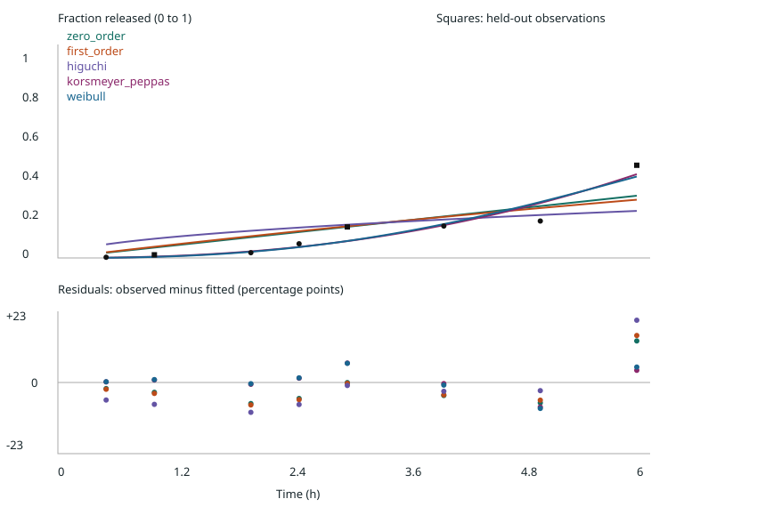
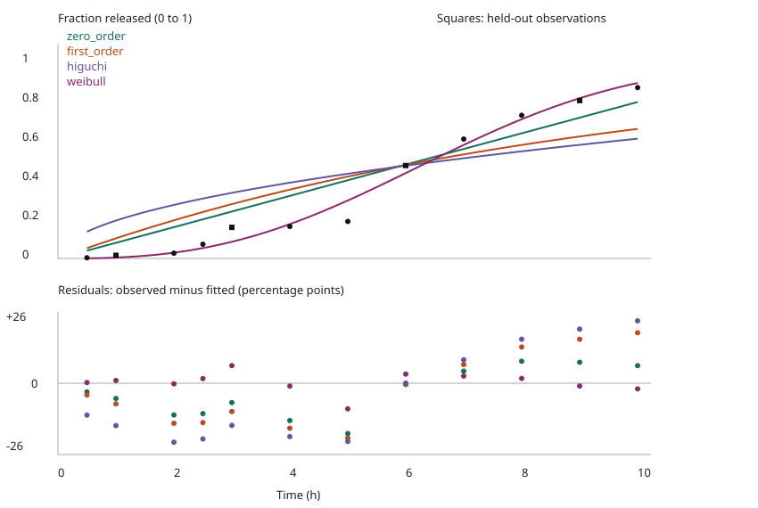

# Ketoprofen F15, published kinetics table

Generated by the command in README.md. No automatic winner is declared.

Source: [Ghosh DP, Mittal A, Gaur A, Sahoo J. Int J Pharm Sci Res. 2020;11(6):2906-2913. DOI: 10.13040/IJPSR.0975-8232.11(6).2906-13](https://ijpsr.com/bft-article/formulation-and-evaluation-of-a-ph-dependent-multi-particulate-colon-targeted-drug-delivery-system-using-powder-layering-technology-of-ketoprofen/?view=fulltext)

Manual transcription of HTML table, percentages divided by 100. No graph digitization. Retrieved 2026-11-05.

Digitization error: none introduced because values are tabulated. Rounding allowance: +/-0.005 percentage points (half of the displayed 0.01 percentage-point step). This is an assumed rounding bound, not a measured experimental error. Exact listed sampling times used; time error not quantified.

Bootstrap draws: 500; seed: 2026.

## Limits and source notes

- Korsmeyer-Peppas is invalid beyond first 60% release; excluded from full-curve scope.
- All models assume zero baseline and known releasable total; do not normalize by last point.
- Holdout is interleaved within one curve, not independent experimental replication.
- Bootstrap intervals assume exchangeable residuals; cumulative errors may be correlated. Intervals are conditional on this curve and model, not biological confidence.
- Do not extrapolate outside observed time range; no mechanism or clinical claims.
- Source discrepancy: kinetics table gives 16.32% at 4 h, while the comparative F15 table gives 14.32%. Values here follow the kinetics table without silently reconciling them.
- Medium pH changes during the experiment. The prose and comparative table also differ on timings. Single-regime fits describe this selected table only; they cannot establish a release mechanism.
- No raw replicate curves or experimental uncertainty available in the selected table. Rounded cumulative points are not independent replicates.

## First 60%

Points: 8; train: 5; held-out: 3. Parameters refit all scope points.

| Model | Held-out RMSE (pp) | AIC | AICc | Parameters [95% interval] | Bootstrap successes |
|---|---:|---:|---:|---|---:|
| zero_order | 15.355 | -37.59 | -35.19 | k=0.052997 [0.04269, 0.071325] | 500 |
| first_order | 15.849 | -36.419 | -34.019 | k=0.058873 [0.045151, 0.083446] | 500 |
| higuchi | 18.632 | -32.169 | -29.769 | k=0.098112 [0.06889, 0.1479] | 500 |
| korsmeyer_peppas | 12.55 | -43.606 | -37.606 | k=0.0067608 [0.0011725, 0.022987]; n=2.3151 [1.5663, 3.3526] | 500 |
| weibull | 12.812 | -42.561 | -36.561 | tau=7.6401 [6.749, 10.023]; beta=2.5668 [1.7018, 3.8012] | 500 |

- Data cannot separate zero_order and first_order: delta AICc < 2; held-out errors unresolved by paired resampling or both <0.1 pp.
- Data cannot separate zero_order and higuchi: held-out errors unresolved by paired resampling or both <0.1 pp.
- Data cannot separate zero_order and korsmeyer_peppas: held-out errors unresolved by paired resampling or both <0.1 pp.
- Data cannot separate zero_order and weibull: delta AICc < 2; held-out errors unresolved by paired resampling or both <0.1 pp.
- Data cannot separate first_order and higuchi: held-out errors unresolved by paired resampling or both <0.1 pp.
- Data cannot separate first_order and korsmeyer_peppas: held-out errors unresolved by paired resampling or both <0.1 pp.
- Data cannot separate first_order and weibull: held-out errors unresolved by paired resampling or both <0.1 pp.
- Data cannot separate higuchi and korsmeyer_peppas: held-out errors unresolved by paired resampling or both <0.1 pp.
- Data cannot separate higuchi and weibull: held-out errors unresolved by paired resampling or both <0.1 pp.
- Data cannot separate korsmeyer_peppas and weibull: delta AICc < 2; held-out errors unresolved by paired resampling or both <0.1 pp.
- higuchi: Higuchi requires sink conditions, constant diffusivity, negligible swelling/erosion and appropriate geometry; not established by fit.
- korsmeyer_peppas: Restricted to observed first 60% release; no mechanism inferred from exponent without geometry and independent evidence.

## Full curve

Points: 12; train: 8; held-out: 4. Parameters refit all scope points.

| Model | Held-out RMSE (pp) | AIC | AICc | Parameters [95% interval] | Bootstrap successes |
|---|---:|---:|---:|---|---:|
| zero_order | 7.0993 | -49.569 | -48.235 | k=0.079782 [0.0707, 0.089585] | 500 |
| first_order | 12.061 | -41.37 | -40.037 | k=0.10809 [0.081598, 0.14975] | 500 |
| higuchi | 17.021 | -34.977 | -33.644 | k=0.19316 [0.147, 0.2461] | 500 |
| weibull | 5.9938 | -70.198 | -67.198 | tau=7.3886 [7.1431, 7.7076]; beta=2.6848 [2.336, 3.1469] | 500 |

- Data cannot separate zero_order and weibull: held-out errors unresolved by paired resampling or both <0.1 pp.
- Data cannot separate first_order and weibull: held-out errors unresolved by paired resampling or both <0.1 pp.
- higuchi: Higuchi requires sink conditions, constant diffusivity, negligible swelling/erosion and appropriate geometry; not established by fit.
